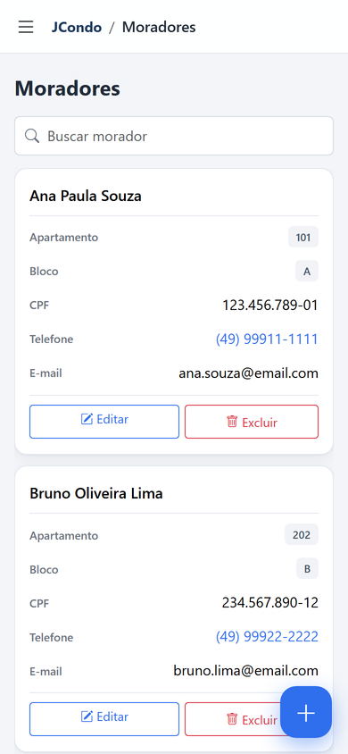
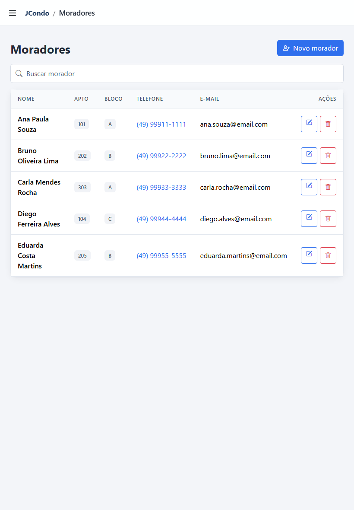
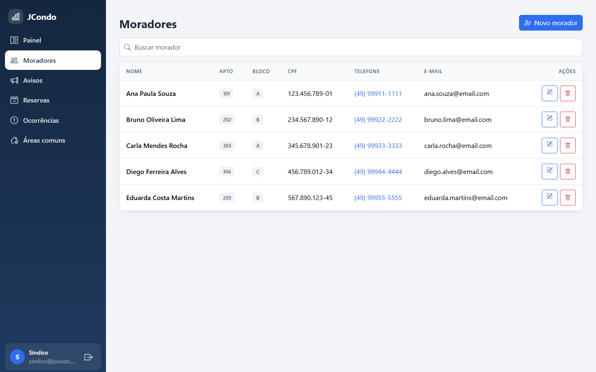
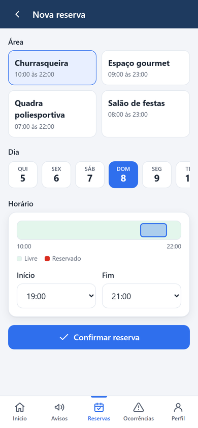
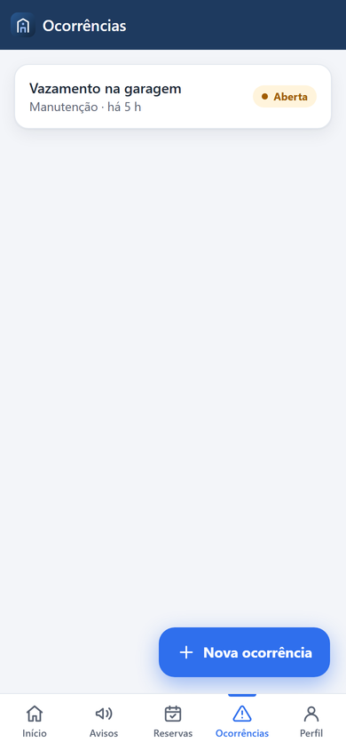
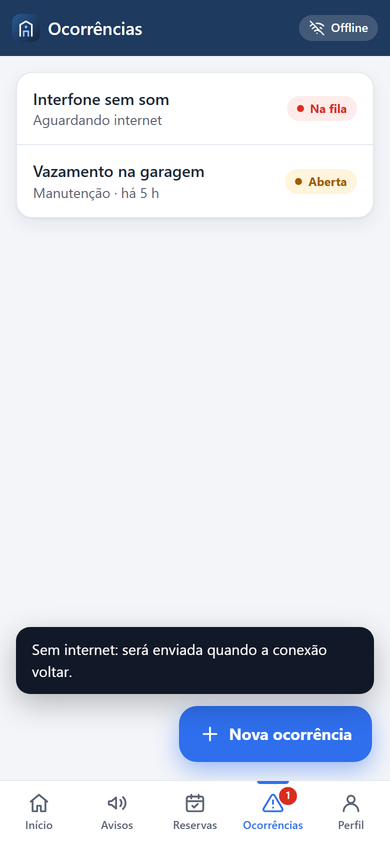

Repositório de Práticas Extensionistas IV - UNOESC

# JCONDO - SISTEMA DE GESTÃO DE CONDOMÍNIO
Jorge Luiz do Nascimento

<p align="justify">
<strong>Introdução</strong>: A gestão de condomínios ainda depende de grupos de mensagens, planilhas e avisos em papel, o que espalha a informação e não gera histórico. <strong>Objetivo</strong>: O JCondo centraliza a gestão do condomínio com um painel web para o síndico, um app PWA para os moradores e uma API REST, cobrindo moradores, avisos, reservas de áreas comuns e ocorrências. <strong>Metodologia</strong>: Java 21 com Spring Boot em camadas, MySQL, Thymeleaf e Bootstrap no painel, PWA em HTML, CSS e JavaScript e API com JWT documentada no Swagger. A aplicação roda em servidor próprio, publicada em HTTPS pelo Cloudflare Tunnel, e o GitHub Actions testa e gera cada versão. <strong>Resultados esperados</strong>: Um sistema na internet que funciona do celular ao computador e pode ser instalado no telefone. <strong>Conclusão</strong>: A separação entre API, painel e app deixa o JCondo pronto para novos módulos.
</p>

<strong>Palavras-chave</strong>: Gestão condominial. Progressive Web App. API REST. Self-hosting.

## Entregas

- Entrega 1: [`doc/PE-IV-Jcondo.pdf`](doc/PE-IV-Jcondo.pdf)
- Entrega 2: [`doc/PE-IV-Jcondo-Entrega2.pdf`](doc/PE-IV-Jcondo-Entrega2.pdf)
- Apresentação: [`doc/PE-IV-Jcondo-Apresentacao.pptx`](doc/PE-IV-Jcondo-Apresentacao.pptx)

## Entrega 2

**1. Responsividade.** O painel do síndico se adapta a celular, tablet e computador: no celular o menu vira gaveta e as tabelas viram cartões.

| Celular | Tablet | Computador |
|---|---|---|
|  |  |  |

**2. Versão mobile (PWA).** O app do morador (`/app/`) instala no celular e funciona sem internet. Uma ocorrência registrada offline é enviada quando a conexão volta.

| Início | Reserva | Ocorrências | Offline |
|---|---|---|---|
|  |  |  |  |

**3. API.** REST em `/api/v1` com JWT, perfis síndico e morador e documentação no Swagger (`/swagger-ui/index.html`). Rotas em [`doc/api.md`](doc/api.md).

**4. Infraestrutura.** Servidor próprio (Java 21 e MySQL 8.4) publicado em HTTPS pelo Cloudflare Tunnel, sem abrir portas. Configuração em [`doc/infraestrutura.md`](doc/infraestrutura.md).

## Como rodar

Servidor completo, com link público:

```
infra\instalar.cmd
infra\iniciar.cmd
```

Só na máquina, sem MySQL: `cd app` e `mvnw.cmd spring-boot:run -Dspring-boot.run.profiles=local`, depois http://localhost:8080.

Acesso de demonstração: síndico `sindico@jcondo.com` / `sindico123`; morador `ana.souza@email.com` / `morador123`.

## Estrutura

- `app/` - aplicação Spring Boot (painel, PWA e API)
- `infra/` - scripts do servidor
- `doc/` - PDFs, apresentação, diagramas e documentação
- `.github/workflows/ci-cd.yml` - testes e geração da versão

## Diagramas


