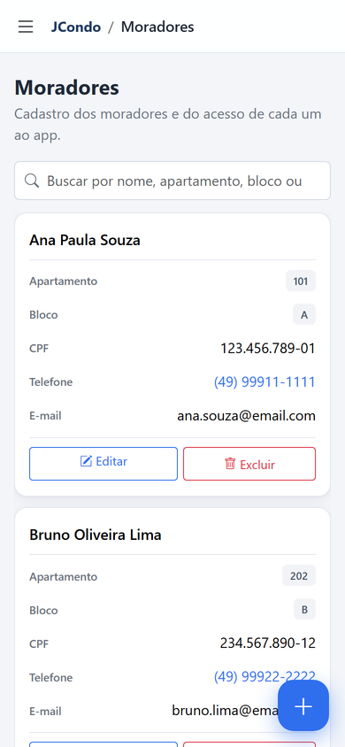
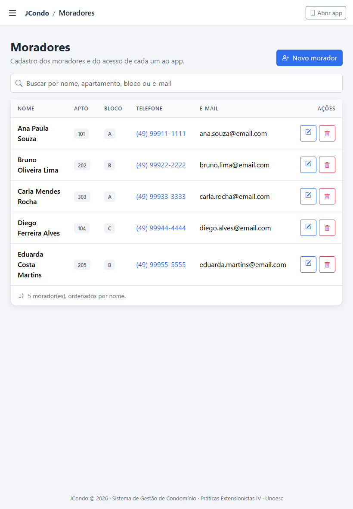
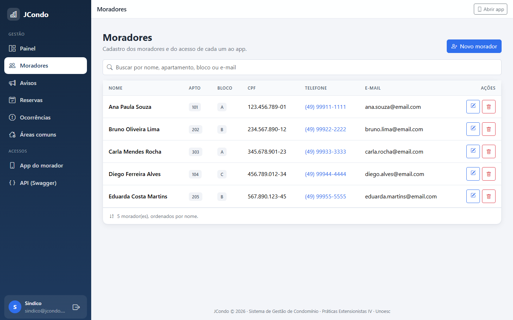
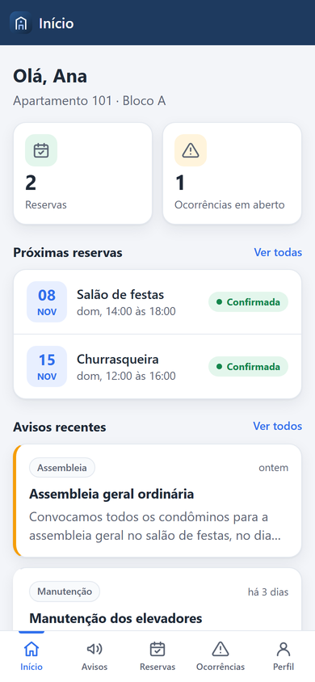
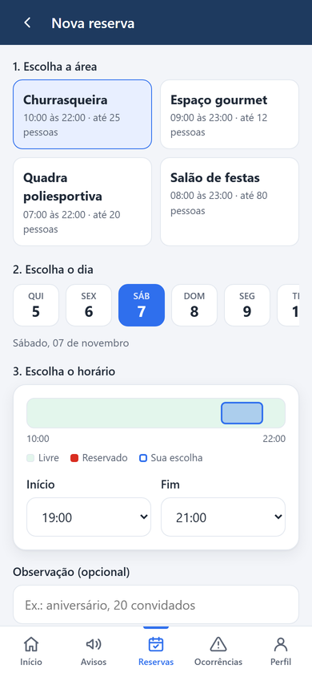
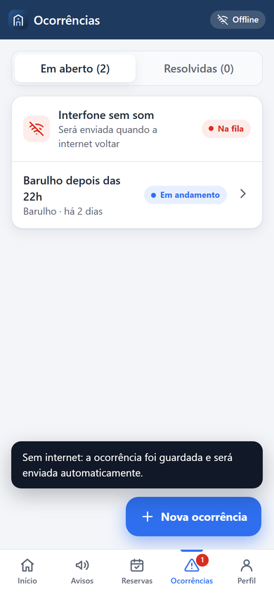
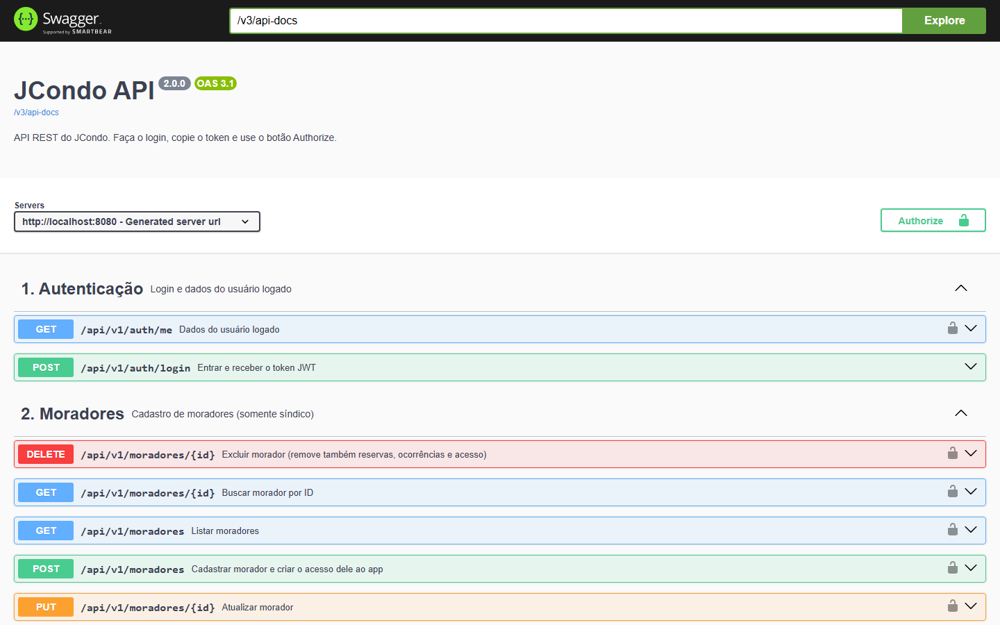
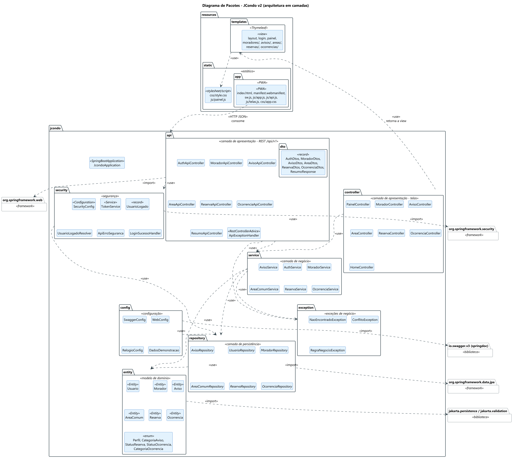
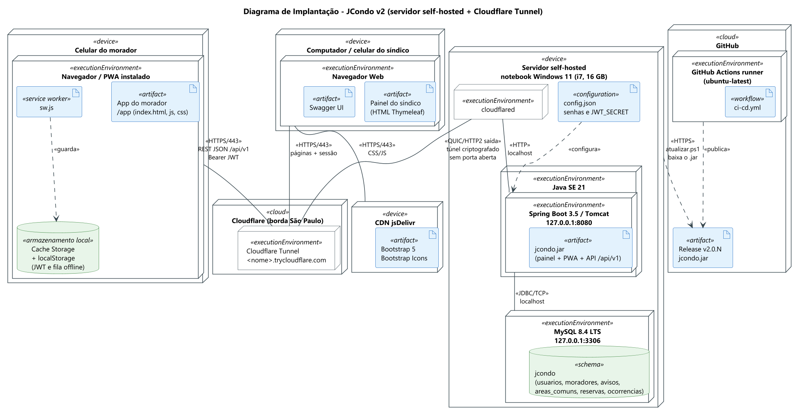
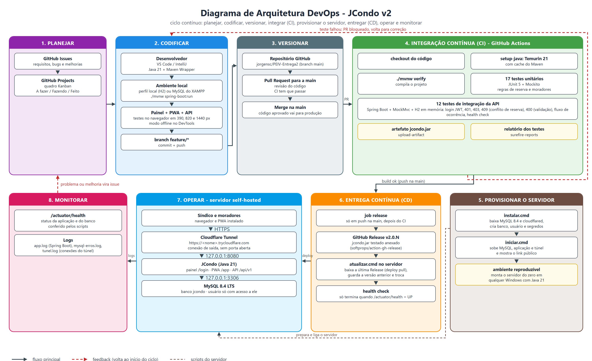

Repositório de Práticas Extensionistas IV - UNOESC

# JCONDO - SISTEMA DE GESTÃO DE CONDOMÍNIO
Jorge Luiz do Nascimento

<p align="justify">
<strong>Introdução</strong>: A gestão de condomínios ainda depende muito de métodos informais, como grupos de mensagens, planilhas e avisos em papel, o que deixa a informação espalhada, dificulta a comunicação entre síndico e moradores e não gera histórico do que acontece no condomínio. <strong>Objetivo</strong>: O JCondo centraliza a administração do condomínio em três frentes: um painel web responsivo para o síndico, um aplicativo mobile no formato PWA para os moradores e uma API REST que liga as duas pontas. O sistema cobre cadastro de moradores, mural de avisos, reserva de áreas comuns sem conflito de horário e registro e acompanhamento de ocorrências. <strong>Metodologia</strong>: A aplicação foi desenvolvida em Java 21 com Spring Boot, em arquitetura de camadas (controller, service, repository e entity), com banco MySQL, painel em Thymeleaf e Bootstrap, app PWA em HTML, CSS e JavaScript com service worker, e API protegida por JWT e documentada com Swagger. A aplicação é hospedada em servidor próprio (self-hosted), com MySQL 8.4 e acesso público em HTTPS pelo Cloudflare Tunnel, sem abrir portas na rede. A montagem do servidor é automatizada por scripts e o GitHub Actions compila, testa e publica cada versão aprovada na branch principal. <strong>Resultados esperados</strong>: Um sistema publicado na internet, que funciona bem do celular ao computador, pode ser instalado na tela inicial do telefone e continua mostrando os dados mesmo sem internet. <strong>Conclusão</strong>: A separação entre API, painel e app, junto com a automação do build e do deploy, deixa o JCondo pronto para crescer com novos módulos sem mudar a forma de publicar.
</p>

<strong>Palavras-chave</strong>: Gestão condominial. Progressive Web App. API REST. Self-hosting.

## Acesso

| O que | Endereço |
|---|---|
O servidor é self-hosted: o endereço público é gerado pelo Cloudflare Tunnel quando o servidor é ligado (`infra\iniciar.cmd`) e tem o formato `https://<nome>.trycloudflare.com`.

| O que | Caminho |
|---|---|
| Painel do síndico (web responsivo) | `/login` |
| App do morador (PWA) | `/app/` |
| API (Swagger) | `/swagger-ui/index.html` |
| Health check | `/actuator/health` |

Usuários de demonstração: síndico `sindico@jcondo.com` / `sindico123` e moradores (por exemplo `ana.souza@email.com`) com a senha `morador123`.

## Entregas

| Entrega | Conteúdo | Onde está |
|---|---|---|
| 1 | Repositório, diagramas de pacotes, implantação e DevOps, escolha da infraestrutura | [`doc/PE-IV-Jcondo.pdf`](doc/PE-IV-Jcondo.pdf) |
| 2 | Responsividade, versão mobile (PWA), API e configuração da infraestrutura | [`doc/PE-IV-Jcondo-Entrega2.pdf`](doc/PE-IV-Jcondo-Entrega2.pdf) |
| Final | Apresentação | [`doc/PE-IV-Jcondo-Apresentacao.pptx`](doc/PE-IV-Jcondo-Apresentacao.pptx) |

## Entrega 2

### 1. Aplicação responsiva

O painel do síndico foi refeito com abordagem *mobile first*. No celular o menu vira uma gaveta, as tabelas viram cartões (cada linha mostra os campos com rótulo) e as ações principais ficam num botão flutuante. No tablet as colunas menos importantes saem para a tabela caber sem rolagem lateral, e a partir de 992 px o menu fica fixo na lateral. Os layouts foram conferidos em 390, 820, 1024 e 1440 px de largura.

| Celular | Tablet | Computador |
|---|---|---|
|  |  |  |

### 2. Versão mobile (PWA)

O app do morador fica em `/app/` e é um Progressive Web App:

- **instalável** na tela inicial do Android e do iPhone (manifest com ícones, ícone *maskable*, atalhos e capturas de tela);
- **funciona offline**: o service worker guarda os arquivos do app e as últimas respostas da API; sem internet o app abre normalmente e mostra o selo "Offline";
- **ocorrência sem internet**: o morador pode registrar uma ocorrência offline, ela fica numa fila no aparelho e é enviada sozinha quando a conexão volta;
- **atualização**: quando sai uma versão nova, o app avisa e atualiza com um toque;
- tema claro e escuro automático, áreas seguras do iPhone, alvos de toque de 44 px.

Funções: tela inicial com resumo, mural de avisos (com compartilhamento), reserva de áreas com a grade de horários ocupados do dia, minhas reservas com cancelamento, abertura e acompanhamento de ocorrências, perfil e troca de senha. Logado como síndico, o mesmo app publica avisos e responde ocorrências.

| Início | Reserva | Ocorrência offline | Síndico |
|---|---|---|---|
|  |  |  |  |

### 3. API REST

API versionada em `/api/v1`, com autenticação JWT, dois perfis (síndico e morador), erros no padrão Problem Details (RFC 9457) e documentação no Swagger. São 27 operações sobre autenticação, moradores, avisos, áreas comuns, reservas, ocorrências e resumo. Detalhes, regras e exemplos em [`doc/api.md`](doc/api.md).



### 4. Infraestrutura self-hosted

O JCondo roda em servidor próprio (Windows 11, Java 21 e MySQL 8.4 LTS) e fica acessível na internet em HTTPS pelo **Cloudflare Tunnel**. O túnel faz uma conexão de saída até a Cloudflare, então nenhuma porta é aberta no roteador e o MySQL e a aplicação escutam só em `127.0.0.1`. O custo é zero.

Tudo é automatizado em [`infra/`](infra): `instalar.cmd` monta o servidor, `iniciar.cmd` coloca no ar e mostra o link público, `atualizar.cmd` publica a última versão gerada pelo pipeline, `backup.cmd` faz o dump do banco e `parar.cmd` desliga. A configuração completa (componentes, parâmetros, rede, segurança, CI/CD, operação, custos e limitações) está em [`doc/infraestrutura.md`](doc/infraestrutura.md).

## Estrutura do repositório

```
PEIV/
├── app/                      aplicação Spring Boot (painel, PWA e API num só .jar)
│   ├── src/main/java/jcondo/
│   │   ├── api/              controllers REST /api/v1 e DTOs
│   │   ├── controller/       telas do painel do síndico
│   │   ├── service/          regras de negócio
│   │   ├── repository/       acesso ao banco (Spring Data JPA)
│   │   ├── entity/           entidades JPA
│   │   ├── security/         login, JWT e perfis
│   │   ├── config/           Swagger, relógio, dados de demonstração
│   │   └── exception/        exceções de negócio
│   ├── src/main/resources/
│   │   ├── templates/        páginas Thymeleaf do painel
│   │   └── static/app/       PWA (manifest, service worker, JS, CSS, ícones)
│   ├── src/test/             testes unitários e de integração da API
│   ├── database/jcondo.sql   esquema do banco
│   └── docs/                 manuais de instalação e execução
├── infra/                    scripts do servidor self-hosted (instalar, iniciar, atualizar, backup, parar)
├── doc/                      PDFs das entregas, diagramas, telas, API e infraestrutura
└── .github/workflows/        pipeline de CI (testes) e CD (Release com o .jar)
```

## Como rodar localmente

Sem instalar MySQL (banco H2 em arquivo):

```
cd app
mvnw.cmd spring-boot:run -Dspring-boot.run.profiles=local
```

Com o MySQL do XAMPP: `mvnw.cmd spring-boot:run`. Depois abrir http://localhost:8080. Os testes rodam com `mvnw.cmd test`. Mais detalhes em [`app/README.md`](app/README.md).

## Diagramas

Versão atual (Entrega 2). As fontes editáveis ficam em `doc/fontes` (PlantUML e HTML). Os diagramas da Entrega 1 continuam em `doc/diagrama-pacotes.png`, `doc/diagrama-implantacao.png` e `doc/diagrama-devops.png`.

**Diagrama de pacotes**



**Diagrama de implantação**



**Diagrama DevOps**


