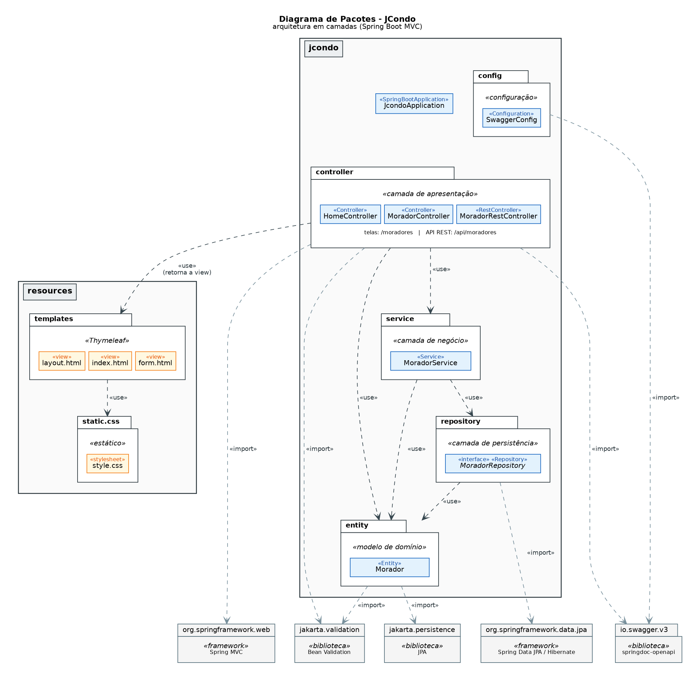
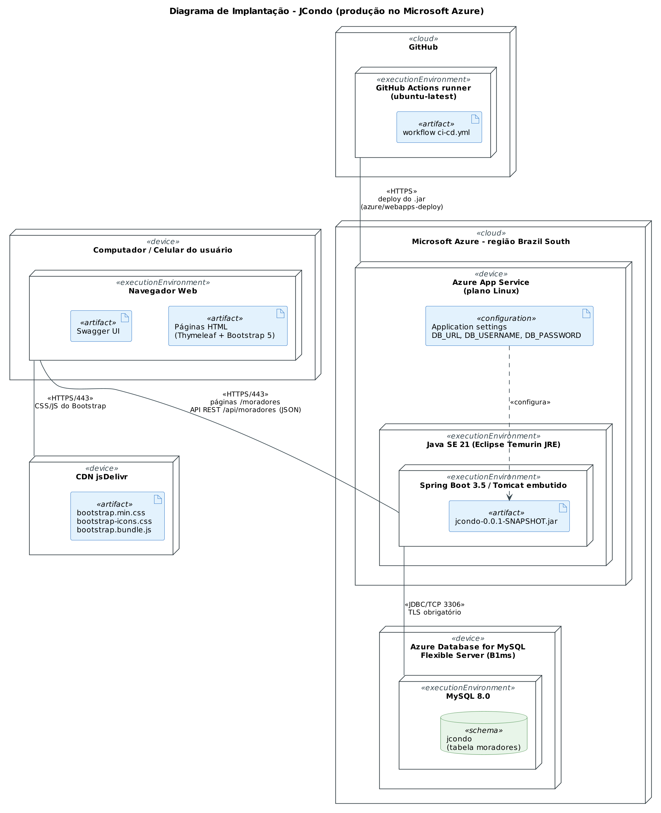
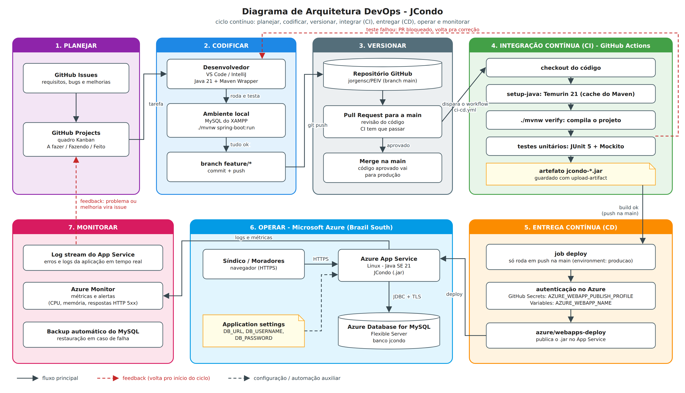

Repositório de Práticas Extensionistas IV - UNOESC

# JCONDO - SISTEMA DE GESTÃO DE CONDOMÍNIO
Jorge Luiz do Nascimento

<strong>Introdução</strong>: A gestão de condomínios ainda depende muito de métodos informais, como grupos de mensagens, planilhas e avisos em papel, o que deixa a informação espalhada, dificulta a comunicação entre síndico e moradores e não gera histórico do que acontece no condomínio. <strong>Objetivo</strong>: O JCondo é um sistema web para centralizar a administração do condomínio. Nesta etapa ele já faz o cadastro completo de moradores (criar, listar, editar e excluir) com interface web e API REST documentada, servindo de base para os próximos módulos (avisos, reservas de áreas comuns, eventos e ocorrências). <strong>Metodologia</strong>: A aplicação foi desenvolvida em Java 21 com Spring Boot, em arquitetura de camadas (controller, service, repository e entity), com banco MySQL, telas em Thymeleaf e Bootstrap e API documentada com Swagger. O código é versionado no GitHub e passa por um pipeline de CI/CD no GitHub Actions, que compila, roda os testes e publica a aplicação no Microsoft Azure (App Service + Azure Database for MySQL). <strong>Resultados esperados</strong>: Um sistema publicado na nuvem, acessível pelo navegador, com deploy automático a cada alteração aprovada na branch principal. <strong>Conclusão</strong>: A organização em camadas junto com a automação do build e do deploy deixa o JCondo pronto para receber novos módulos com um processo de publicação simples e repetível.

<strong>Palavras-chave</strong>: Gestão condominial. Spring Boot. DevOps. Microsoft Azure.

## Estrutura

- `app/` - código da aplicação (Spring Boot), com manuais de instalação e execução em `app/docs`
- `doc/` - entrega parcial em PDF e os diagramas de pacotes, implantação e DevOps
- `.github/workflows/ci-cd.yml` - pipeline de build, testes e deploy no Azure

## Diagramas

**Diagrama de pacotes**

**Diagrama de implantação**

**Diagrama DevOps**

